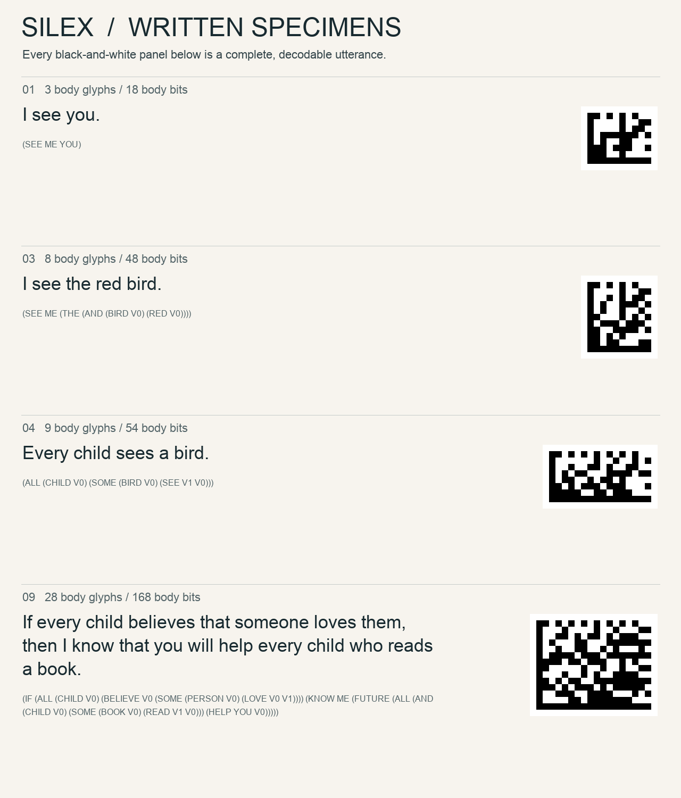

# Silex

An experimental visual language for compositional meaning, with a browser-local converter.

**[Open the converter](https://project.christiantadros.com/silex-converter)** · **[Language specification](docs/Silex-Specification.md)** · **[Meaning-graph format](docs/Meaning-Graphs.md)** · **[Research report](reference/Silex-Research-Report.pdf)**



Silex separates meaning from its visual carrier. Its 64 glyphs each contain six binary sites in two columns and three rows, weighted `32,16 / 8,4 / 2,1`. Fixed-arity heads, counted calls, explicit variable scope, exact numbers, UTF-8 literals, functions, and declared concepts support arbitrary finite descriptions. The complete image also pays for its border, length, checksum, and padding.

For example, the original formal grammar distinguishes:

```text
Every child sees a bird.
(ALL (CHILD V0) (SOME (BIRD V0) (SEE V1 V0)))

There is one bird that every child sees.
(SOME (BIRD V0) (ALL (CHILD V0) (SEE V0 V1)))
```

## Translate and inspect

1. Enter text, choose its language, and press **Translate**.
2. Review the model’s literal meaning graph and the source words retained in the image.
3. Select a concept, relation, source word, or glyph to highlight the fields and dictionary entry that encode it.
4. Download PNG/SVG or copy the image.
5. Choose **Silex image** to decode a complete raster panel locally.

English translation uses **a trained AMR meaning parser**, amrlib’s BART-base model, converted to quantized ONNX. It does not match a list of sentences or use the hand-written English grammar. A trained UDPipe tokenizer splits documents into statements; the model processes each statement and a deterministic compiler writes the resulting graphs into Silex. Repeated statements remain separate, with references local to each graph. Concepts and relation labels are open strings.

The first English translation downloads about **270 MB** of model/runtime assets. Subsequent attempts reuse the browser cache. Inference runs on the CPU in a background worker, using up to four threads when cross-origin isolation is available; English does not require WebGPU. The page shows checked download bytes, the current statement, generated-output activity, elapsed time, and an animated indicator. **Stop** terminates the worker immediately. Editing the input cancels the previous attempt; exports remain disabled until a new result is ready.

Spanish, French, German, Italian, Portuguese, Mandarin, Japanese, Korean, Arabic, Hindi, and Russian use an optional **Qwen3.5 4B** language model through WebLLM. It translates ordinary text into English before meaning parsing. It requires WebGPU, shader-f16, approximately 2.4 GB of downloaded files and sufficient GPU memory. Both the original words and the English intermediate are retained in these images. To read an image in its original language, no AI is needed. Translation into another language uses the optional local language model.

The original scoped grammar remains available through **Silex expression**, including precise quantifier scope and arbitrary declared predicates. Older images remain decodable. The legacy example grammar is retained for compatibility tests; it is not the text translator’s runtime path.

## What the image contains

The [meaning-graph convention](docs/Meaning-Graphs.md) uses the existing `PAIR`, `TEXT`, `CALL`, `SYMBOL`, and `NAT` heads. A counted UTF-8 dictionary contains concepts, roles, values, source words, and whitespace. Each statement contains a root, concept nodes, directed relations, typed values, and its source atoms. Shared dictionary entries save repetition; they do not merge statements or node identities.

Every declaration, reference, separator, and source witness costs real image area. There is no external per-image vocabulary database or hidden attachment. The original Python codec can decode the enclosing expression; interpreting its graph convention requires the published graph specification and shared AMR/English grounding knowledge. The encoder’s neural weights are not needed to recover the graph or source words.

The converter never treats a whole-sentence quotation as a successful meaning analysis. **Preserve exact wording** remains a separate, explicitly identified text-literal mode. Normal translation requires a real meaning graph.

## Privacy

Sentences, images, and model inference stay in the browser. Images are decoded from pixels using local file APIs. There is no upload endpoint, remote inference, account, analytics, or server storage for visitor images. Model downloads are ordinary static-file requests; optional language-model downloads contact Hugging Face and GitHub. Model caches occupy the visitor’s device storage.

Use an intact PNG or crisp lossless raster panel with its white margin. Integer scaling and rotations are supported. Photos, blur, captions, cropping, and noninteger resizing may fail safely. Clipboard support depends on the browser; downloading a PNG is the fallback.

## Run locally

Use Node.js 22.12 or newer:

```sh
npm ci
npm run prepare-model
npm test
npm run dev
```

Open `http://localhost:8792/silex-converter/`. Model assets are downloaded from this repository’s versioned public release and verified against [SHA-256 checksums](models/manifest.json). They are separate from Git source history. See [model preparation](docs/Model-Preparation.md) to reproduce the conversion or run the actual-model regression check.

`npm run deploy` builds and publishes the static converter to the account/route in `wrangler.jsonc`. A Cloudflare login is required. For another deployment, change that configuration. No inference API keys or image-storage credentials are needed. GitHub Actions checks source and builds; it does not deploy.

The independent Python reference can encode/decode the original wire format:

```sh
python3 -m pip install Pillow
python3 reference/silex_codec.py '(SEE ME YOU)' --png message.png
python3 reference/silex_codec.py --decode-png message.png
```

## Evidence and limitations

The new trained pipeline completed **243 inputs containing 252 statements**, including 67 externally sourced English texts, without graph-compilation or codec-round-trip failures. Every original character was recovered from the encoded source atoms. Three model outputs needed completed closing brackets, which are reported as interpretation notes. This checks operational reliability, not universal semantic accuracy. Browser checks and the distinction between unit tests, model tests, and live deployment evidence are recorded in [Verification](docs/Verification.md).

AMR is an interpretation representation, not complete first-order semantics. It does not fully specify tense, articles, exact quantifier scope, or cross-sentence coreference. A model can choose the wrong concept, identity, attachment, or role. For example, the tested biological sentence classified a mitochondrion as an enzyme. Source words preserve information the graph omitted or misinterpreted, but they do not make the graph correct. Review both. The formal language’s expressiveness and the automatic translator’s accuracy are different claims.

The original 13-example area experiment found Silex 8.6% smaller than English and 16.3% larger than Mandarin at equal nominal 32-pixel character height. It did not control recognition error or measure semantic entropy. Those results apply to the original scoped specimens, **not** these larger graph-and-source packages. No universal density optimum or universal translation accuracy is claimed. See the specification and [research records](research) for measurement definitions and decoder costs.

| Path | Contents |
|---|---|
| `src/codec.js` | Original syntax, framing, rendering, and pixel decoding |
| `src/meaning-worker.js`, `src/meaning.js` | Trained local interpretation and cancellation |
| `src/meaning-graph.js` | Open graph compilation, decoding, and visual field maps |
| `src/document-segments.js`, `src/model-assets.js` | Learned boundary adapter and verified asset caching |
| `src/ai.js`, `src/ai-worker.js` | Optional local language translation |
| `src/app.js`, `src/index.html`, `src/style.css` | Converter interface |
| `scripts/`, `models/manifest.json` | Model reproduction, downloads, and integrity records |
| `reference/`, `docs/`, `research/` | Language specification, visual atlas, reports, and provenance |
| `tests/` | Codec, graph, legacy compiler, and streaming checks |

Dependencies are pinned. Attribution and component licenses are in [third-party notices](THIRD-PARTY-NOTICES.md).
