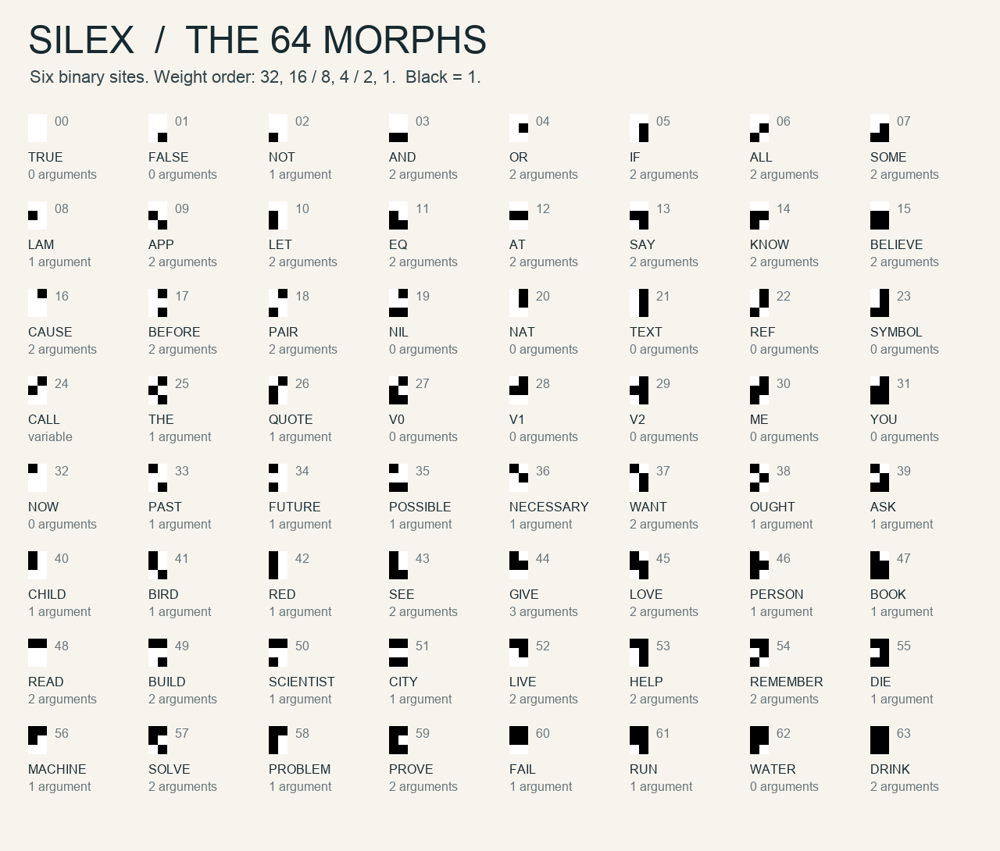
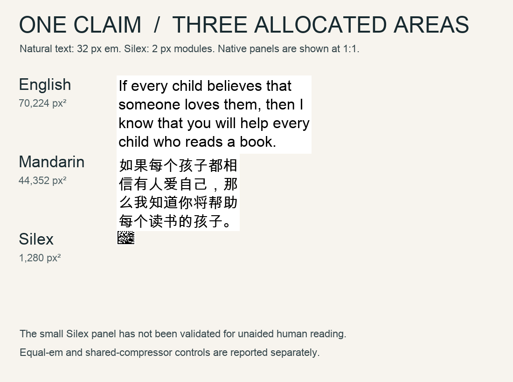

# SILEX

## A visual semantic language, version 1

Experimental design and executed prototype. 11 October 2026.

Silex represents a meaning as a scoped expression, gives frequent expression heads one small glyph, and packs the glyphs into a binary visual lattice. Its novelty here is the particular language, codebook, binding rules, and writing protocol. Binary matrices, prefix coding, modal logic, and lambda calculus are established ideas. This is an original design proposal, not a claim that every ingredient or the name is unprecedented.

The deliverables include an exhaustive 64-glyph atlas, 13 worked translations, native and enlarged written specimens, a reference encoder and decoder, an area benchmark, and executed verification. The strongest result is qualified: a very small decoder-oriented display is possible, but an advantage over ordinary typography depends greatly on the display assumptions and shared dictionary. Silex has not been established as a global optimum or tested with human readers.

## 1. What the objective can mean

Visual density has two independent limits: how succinctly we describe the intended meaning, and how reliably we distinguish marks in an area. Removing a word does not necessarily save visual information. Moving a whole sentence into a dictionary does not remove its description cost.

Let X be a chosen formal meaning, R the reader's shared knowledge, A the allocated visual area, and epsilon the allowed decoding error. The design objective is high J(X | R)/A, with conditional surprisal J(X | R) = -log2 P(X | R). An empirical distribution over meanings would be needed to estimate J. No such distribution is claimed in this experiment.

For lossless coding of a source, expected code length is constrained by its conditional entropy. With a binary visual channel having at most one independently distinguishable bit per area u squared, ideal average area is bounded below by H(X | R) times u squared, before framing and reliability costs. This is a model of a channel, not a theorem about how much meaning a person perceives. [Shannon's original paper](https://people.math.harvard.edu/~ctm/home/text/others/shannon/entropy/entropy.pdf) supplies the source-coding foundation; the semantic objects and visual channel below are assumptions of this experiment.

The full accounting is:

```
L_total = L(decoder, grammar, lexicon | prior knowledge)
        + sum L(message | decoder, grammar, lexicon, declared context)
A_total = A_bootstrap + sum A_message
```

This follows the description-length discipline of paying for both model and data. [Rissanen's original paper](https://research.ibm.com/publications/modeling-by-shortest-data-description) and [Grunwald's tutorial](https://arxiv.org/abs/math/0406077) motivate that accounting. The measured file sizes below are engineering upper bounds, not minimum descriptions of human understanding.

There can be no universally best code without fixing a source, visual channel, and prior. A distribution concentrated on one sentence favors a different code from a distribution of new names, proofs, or poetry. For any proposed finite code, another can shorten a favored message while lengthening others. At finite area and resolution there are only finitely many distinguishable images, so an unbounded set of ideas necessarily requires unbounded area.

To compare paired renderings of the same selected claim, its information numerator is held fixed. The directly measured quantity is therefore an area ratio. Six times the number of Silex body glyphs is the serialized description length in bits; it is NOT an estimate of semantic entropy.

## 2. Designs explored before choosing the prototype

These are analytic design comparisons. Only the selected lattice prototype has been implemented and measured; the alternatives have not undergone an empirical optimization contest.

| Architecture | What carries meaning | Why it could be dense | Where its cost appears |
|---|---|---|---|
| Whole-idea ideographs | One learned picture per message | One mark for a frequent complete idea | An unbounded dictionary; arbitrary new ideas need new entries. Rejected as the forbidden sentence-character shortcut. |
| Pictorial feature bundles | Object silhouettes with property overlays | Simultaneous properties occupy one figure | Distinguishing many overlaps forces larger features; negation, scope, identity, and abstract relations still need syntax. |
| Port-connected semantic graphs | Nodes are entities; edge ports give argument roles | Repeated entities occur once; topology replaces some words | Wire crossings, port labels, routing gaps, and long edges consume area. A star or complete graph is a hostile layout. |
| Nested spatial regions | Quantifier and modality frames contain their scopes | Containment directly determines scope; parentheses disappear | Deep nesting needs several boundary widths; its rectangular packing can leave large voids. |
| Algebraic feature glyphs | Strokes specify predicate, tense, role, and polarity | Several frequent distinctions share one glyph | A 2^k glyph inventory still carries only k independent binary choices; overlays do not defeat resolution limits. |
| Multiscale/fractal writing | Position and detail at increasingly fine scales | Many levels fit inside one geometric boundary | At fixed minimum feature size, detail runs out. Magnification spends display area or reading time. |
| Pure compressed text in a matrix | A compressor encodes an existing sentence | Excellent carrier utilization with an established language | This changes the carrier, not the language; a decoder and model must be shared. It is an essential control. |
| Scoped expressions in a lattice | A compositional meaning tree plus local bindings | Fixed arity removes separators; variables share entities and definitions; binary cells use the channel directly | Formalization choices, learned head meanings, literal payloads, framing, and error control. Selected. |

I abandoned free-form semantic wiring as the default physical layout. Its attraction is genuine for some diagrams, but topology is information that must also be transmitted. In Silex, shared references express the graph; a regular lattice carries it. Two dimensions optimize packing rather than introduce a spatial metaphor for truth.

There is no claim that square black-and-white modules are best for every observer or medium. Color, orientation, gray levels, and time could enlarge channel capacity, but only if their distinguishable states and associated error rates are specified. This prototype uses static binary contrast and a minimum module width u.

## 3. The chosen system

Silex has three layers:

1. A semantic expression with explicit scope, ordered arguments, and local binders.
2. A prefix code using a closed set of 64 expression heads and self-delimiting payloads. This set is a small built-in vocabulary, not a limit on expressibility.
3. A two-dimensional lattice of six-site glyphs, with timing borders, a length header, and a checksum.

There is no spoken form, spelling, capitalization, or phonetic alphabet. The English head names used in the specification are explanatory transliterations. None of their letters appear in the actual Silex panels.

The design is optimized for a trained or assisted decoder. It does not preserve English word order, grammatical gender, articles that add no selected semantic distinction, or natural-language redundancy automatically. It DOES require paying for distinctions that matter: definiteness, scope, referents, tense when asserted, uncertainty, source attribution, and exact quoted text.

## 4. Foundational glyphs and physical writing

Each glyph has two columns and three rows of square binary sites:

```
32 16
 8  4
 2  1
```

Black means 1 and white means 0. Sum the black-site weights to identify the head. There are exactly 64 patterns, from a completely white tile to a completely black tile. This is a compositional alphabet whose construction rule is much smaller than 64 unrelated drawings.

Examples: AND has value 3, so its two bottom sites are black. ALL has value 6, so the middle-right and bottom-left sites are black. SEE has value 43 = 32 + 8 + 2 + 1. ME is 30 and YOU is 31. The fixed high bit often separates the structural half from the common-content half, but head meaning still comes from the registry; resemblance does not license guessing.



In the dense edition glyphs touch. Their black regions may fuse. The frame establishes the grid, so glyph boundaries remain fixed even where there is no visible white gap. The blank TRUE glyph occupies a real, counted tile; invisible blank tiles are not free storage. In the reading edition, glyphs can be separated and labeled. That enlargement is an aid to inspection and is not the density benchmark.

At module width u, a glyph occupies 2u by 3u, or 6u squared. Its maximum payload is six bits. That saturates the assumed binary-cell capacity INSIDE the payload, but syntax restricts which glyph sequences are meaningful, and the whole frame incurs overhead. No above-capacity compression is claimed.

### Framing, layout, and robustness

For c glyph columns and r glyph rows, payload dimensions are 2c by 3r modules. Left and bottom borders are solid. Top and right borders alternate. A one-module quiet zone surrounds the border. The resulting total rectangle is:

```
W = 2c + 4
H = 3r + 4
A = W * H * u^2
```

Read glyphs left to right within each glyph row, then top to bottom. Each glyph is read top-left, top-right, middle-left, middle-right, bottom-left, bottom-right. Physical line breaks do not change grammar or scope.

The direct frame content is:

```
profile=1 ; U(body_word_count) ; body ; crc_high ; crc_low ; zero padding
```

The checksum is 12 bits, split into two six-bit words. Parameters are polynomial 0x80F, initialization 0xFFF, most significant bit first, no final XOR. It covers the profile tag, encoded count fields, and transmitted payload. There are four overhead glyphs when the body count fits one integer word; larger counts pay for additional count words. Layout padding is included in area and must be zero. The renderer searches all possible column counts and selects minimum rectangle area, then least padding, then an aspect ratio closest to square.

An optional compressed profile retains the identical semantic expression and uses this frame content:

```
profile=2 ; U(compressed_byte_count) ; U(decoded_body_word_count)
          ; six-bit-packed zlib bytes ; crc_high ; crc_low ; zero padding
```

First pack the body's six-bit words into bytes with zero padding, then encode a zlib stream using the [RFC 1950 format](https://www.rfc-editor.org/rfc/rfc1950). The reference encoder uses zlib level 9. Validate its stream termination, exact decompressed length, both layers of zero padding, checksum, and final expression syntax. The decoder selects the algorithm from the explicit profile tag. No compression codebook is inferred from an English caption. The default encoder computes both profiles' complete framed areas and chooses the smaller frame, then the smaller packet, and finally the direct profile. The 13 comparison examples all select the direct profile, so their reported measurements are unchanged. The compressed profile is useful for longer repeated data or syntax; it makes individual body glyph meanings inaccessible until decompression. The zlib implementation is part of the specified shared runtime prior and would need an additional charge if the reader lacks it.

In an executed stress probe, an exact TEXT literal containing 1,000 repeated ASCII a characters required 35,200 square pixels in the direct profile and 1,368 square pixels in the automatically selected compressed profile, at u = 2 pixels. The complete compressed PNG decoded back to all 1,000 exact characters. This 25.73-fold transport reduction exploits repetition in that particular literal; it is not a general semantic-density estimate.

The border distinguishes upright orientation. The reference raster decoder requires an intact, upright, integer-scaled panel. It checks every module and the frame, then verifies the checksum, rather than sampling only convenient center pixels. It infers scale from the intact quiet zone; it needs no per-message semantic sidecar. Cropping, blur, perspective, reflections, and arbitrary camera images require additional detection software that has not been built here.

CRC is error detection, not correction. All single-bit header, body, and checksum corruptions of a tested real packet were rejected. Longer random corruptions can occasionally collide; 12 bits give only an approximately 1/4096 random-collision scale under appropriate error assumptions. There is no protection against a deliberate valid substitution. A production channel would need an empirically chosen error-correcting code and finder design. Its overhead would have to be counted for every competing representation.

## 5. Complete compositional syntax

The registry below is normative. A head with fixed arity k is followed by exactly k expressions. Neither parentheses nor spaces are transmitted. NAT, TEXT, REF, SYMBOL, and CALL have the additional payload rules below. The notation in parentheses is solely the readable reference notation.

```
Expression := FixedHead Expression^arity
            | NAT U
            | REF U
            | TEXT U(byte_count) SixBitWords(byte_count)
            | SYMBOL U(byte_count) SixBitWords(byte_count)
            | CALL U(argument_count) Expression Expression^argument_count
```

CALL's first expression denotes the function or relation. Zero-argument CALL is allowed and contains only that function expression. Semantic type validity is a separate requirement from this finite syntactic parse.

### Unsigned integers and literal payloads

U is a little-endian base-32 integer code. Each six-bit word contains five data bits; bit 32 says another integer word follows. The final word has bit 32 clear. Zero is one zero word. A final zero data group after an earlier group is forbidden, eliminating longer alternative representations of the same integer.

For example, 37 is transmitted as [37, 1]: low data digit 5 with continuation set, followed by high digit 1. NAT 37 consequently has three glyphs: the NAT head and those two payload words. A number needs a finite but unbounded number of words.

TEXT and SYMBOL carry a UTF-8 byte count, then the bytes packed most significant bit first into six-bit words. The final word is zero-padded at the low end. Padding is validated. Invalid UTF-8 is rejected. Unicode normalization is not silently applied: composed and decomposed spellings can remain different exact literals. An empty TEXT is permitted; an empty SYMBOL identifier is rejected.

TEXT is uninterpreted exact text. It is not automatically treated as a meaning definition or executed program. SYMBOL is a declared semantic identifier whose denotation and signature must be supplied by the shared model or a paid definition. A short hash or familiar-looking identifier cannot magically teach the reader its denotation.

### Local variables and binding

V0 means the innermost bound variable, V1 the next outer variable, and V2 the next. Larger distances use REF U(distance). The head shortcuts V0, V1, and V2 are canonical; REF 0, REF 1, and REF 2 are rejected on the wire.

ALL and SOME introduce one binder that scopes over BOTH their restriction and body. LAM introduces a binder over its body. THE introduces a binder over its restriction. LET introduces a binder only over its second argument, leaving the definition in the outer environment. Unbound references are errors. QUOTE requires its quoted expression to be closed; it resets the binding environment for validation.

There is no implicit pronoun resolution. A writer chooses a reference, quantifier, or declared contextual entity. If natural-language ambiguity is intended, it must be expressed as a disjunction, a set of readings, or an explicit underspecified object with paid parameters.

### Head registry

| ID | Head | Children | Meaning or ordered roles |
|---|---|---|---|
| 0 | TRUE | 0 | constant true proposition |
| 1 | FALSE | 0 | constant false proposition |
| 2 | NOT | 1 | proposition -> proposition |
| 3 | AND | 2 | proposition, proposition |
| 4 | OR | 2 | proposition, proposition |
| 5 | IF | 2 | antecedent, consequent; material implication |
| 6 | ALL | 2 | bound restriction, bound body |
| 7 | SOME | 2 | bound restriction, bound body |
| 8 | LAM | 1 | one bound body |
| 9 | APP | 2 | function, argument |
| 10 | LET | 2 | definition, body with bound definition |
| 11 | EQ | 2 | two values of the same declared type |
| 12 | AT | 2 | context, proposition |
| 13 | SAY | 2 | agent, proposition content or exact text |
| 14 | KNOW | 2 | agent, proposition; factive |
| 15 | BELIEVE | 2 | agent, proposition |
| 16 | CAUSE | 2 | cause event, effect event |
| 17 | BEFORE | 2 | earlier event, later event |
| 18 | PAIR | 2 | first value, second value |
| 19 | NIL | 0 | empty sequence |
| 20 | NAT | 0 | unsigned integer payload |
| 21 | TEXT | 0 | UTF-8 literal payload |
| 22 | REF | 0 | binding-distance payload |
| 23 | SYMBOL | 0 | UTF-8 semantic-identifier payload |
| 24 | CALL | variable | argument count, function, counted arguments |
| 25 | THE | 1 | bound unique-entity restriction |
| 26 | QUOTE | 1 | closed expression as exact syntax |
| 27 | V0 | 0 | innermost bound value |
| 28 | V1 | 0 | next outer bound value |
| 29 | V2 | 0 | third bound value |
| 30 | ME | 0 | utterance speaker |
| 31 | YOU | 0 | utterance addressee |
| 32 | NOW | 0 | utterance context c0 |
| 33 | PAST | 1 | proposition at some earlier time |
| 34 | FUTURE | 1 | proposition at some later time |
| 35 | POSSIBLE | 1 | proposition in some accessible world |
| 36 | NECESSARY | 1 | proposition in all accessible worlds |
| 37 | WANT | 2 | agent, desired proposition |
| 38 | OUGHT | 1 | proposition in all normative ideal worlds |
| 39 | ASK | 1 | proposition or closed answer function |
| 40 | CHILD | 1 | entity is a child |
| 41 | BIRD | 1 | entity is a bird |
| 42 | RED | 1 | entity is red |
| 43 | SEE | 2 | viewer, viewed entity |
| 44 | GIVE | 3 | giver, given entity, recipient |
| 45 | LOVE | 2 | lover, loved entity |
| 46 | PERSON | 1 | entity is a person |
| 47 | BOOK | 1 | entity is a book |
| 48 | READ | 2 | reader, read entity |
| 49 | BUILD | 2 | builder, built entity |
| 50 | SCIENTIST | 1 | entity is a scientist |
| 51 | CITY | 1 | entity is a city |
| 52 | LIVE | 2 | resident, inhabited place |
| 53 | HELP | 2 | helper, helped entity |
| 54 | REMEMBER | 2 | rememberer, remembered entity or content |
| 55 | DIE | 1 | entity dies in the evaluation context |
| 56 | MACHINE | 1 | entity is a machine |
| 57 | SOLVE | 2 | solver, solved problem |
| 58 | PROBLEM | 1 | entity is a problem |
| 59 | PROVE | 2 | prover, proposition proved |
| 60 | FAIL | 1 | entity/project fails in the evaluation context |
| 61 | RUN | 1 | entity runs in the evaluation context |
| 62 | WATER | 0 | water substance/type value |
| 63 | DRINK | 2 | drinker, consumed substance/entity |


All fixed content predicates are evaluated relative to a model and context. Their role order is stable. GIVE(giver, thing, recipient) does not change order in passive descriptions. A passive construction simply moves the relevant quantifier or changes what is asserted about the participants.

### Why the parse is unique

At an expression boundary, the first six-bit glyph determines the one head. After the declared carrier profile has been decoded, its registry entry fixes how many children follow or identifies one self-delimiting payload. Continuation integers terminate uniquely; literal byte counts fix exactly how many words follow; CALL fixes its child count. Applying this argument recursively yields one finite expression tree or a rejection. Binder distances then determine one syntactic referent. The packet count and validated zero padding fix where that expression ends.

This establishes unique decoding relative to the version-1 registry. It does not prove that two authors share an ontology, that all assertions are true, or that two different formulas can never be logically equivalent. General equivalence testing and executing an arbitrary program are not required for decoding.

## 6. Compositional meaning

Use a declared model M, evaluation context c, utterance context c0, and binding environment g. A context includes a world, time, and relevant domain restriction. The utterance context fixes speaker, addressee, and grounding. Deictic ME and YOU remain those utterance participants under modality and quotation; NOW denotes c0. A contextual domain restriction is shared knowledge and must be declared or transmitted if the reader lacks it.

The model supplies entities, events, contexts, typed values, relations, and accessibility relations. Sort and ordinary content predicates are total relations over the declared domain: values outside their appropriate extension give false, rather than making an entity quantifier fail on a nonmember. The ordered role labels constrain eligible tuples. Operators such as APP and AT still require a function and a context respectively; misusing those value types is a semantic error. A quantified body is required only for values satisfying its restriction. Ordinary predicates such as SEE return propositions. A proposition-taking operator receives a proposition's context-dependent content, not just its current true/false bit. Otherwise every true belief complement would collapse to the same content. The fixed attitude operators use the truth-conditional possible-world convention below; explicitly quoted syntax permits finer distinctions when required.

| Constructor | Meaning rule |
|---|---|
| TRUE, FALSE | Constant true and false propositions. |
| NOT P | Classical negation of P. |
| AND P Q; OR P Q | Ordered syntactic conjunction or inclusive disjunction; the truth rules are classical. |
| IF P Q | Material implication: NOT P OR Q. Counterfactuals and causation require different declared operators. |
| ALL R B | For every x in the current domain, if R under environment [x]+g holds, B under that same environment holds. No existence is implied. |
| SOME R B | For some x, both R and B under [x]+g hold. |
| LAM E | A function of x whose body is E under [x]+g. |
| APP F X | Apply F to X. CALL permits a declared n-argument function/relation. |
| LET E B | Evaluate the definition E in g; bind its resulting value while interpreting B. It is local, hygienic sharing. |
| EQ X Y | Identity/equality in the declared type, not approximate resemblance. |
| THE R | The unique x in the contextual domain satisfying R; otherwise a presupposition failure, not a guessed referent. |
| AT C P | Evaluate P at the explicit context denoted by C, retaining utterance grounding and outer bound entities. |
| PAST P; FUTURE P | P holds at some earlier/later time in the same world relative to c. They are existential temporal operators, not automatic English aspect. |
| POSSIBLE P; NECESSARY P | P holds at some/all accessible worlds, retaining the time and outer environment unless the declared accessibility relation specifies otherwise. |
| BELIEVE A P | P holds throughout A's belief alternatives. This is truth-conditional belief, not a guarantee of computational logical omniscience in real people. |
| KNOW A P | P holds at c and throughout A's epistemic alternatives; the explicit current-world condition makes this operator factive. |
| WANT A P | P holds throughout A's designated preferred alternatives; empty preference sets are a model presupposition failure. |
| OUGHT P | P holds throughout the designated normative ideal alternatives; those alternatives must be nonempty. |
| SAY A X | The model records A expressing proposition content X or exact text X. Truth of that content is not asserted. |
| ASK X | A question act. For a proposition, the alternatives are X and NOT X; for a closed function, its requested satisfying values define an open question. |
| CAUSE E F | A declared causal relation between events E and F. It is a primitive causal commitment, not derived from temporal order. |
| BEFORE E F | End time of event E precedes start time of event F. Event terms must be explicitly denoted. |
| PAIR X Y; NIL | Ordered pairing and the empty sequence; nested pairs construct arbitrary finite structures. |
| NAT U; TEXT ... | Exact natural-number and UTF-8 string values. |
| SYMBOL ... | A grounded model identifier. Unrecognized identifiers are unresolved, not guessed. |
| QUOTE E | Exact closed expression syntax as data, without asserting or reducing E. |
| V0/V1/V2; REF U | The value at the stated distance in g. |
| Content heads 40-63 | The stable roles stated in the registry, with model-supplied groundings. WATER denotes the water substance/type object used by the model. |

Correctly typed propositions are asserted when they are the root of an utterance. A root ASK performs its question act. Other root values are presented/described. Invalid semantic argument types do not receive alternative meanings: they are type errors. Decoding is total on valid finite syntax, whereas semantic evaluation can be partial, presupposition-dependent, or undecidable.

The current codec checks arity, binding, literal encoding, canonical representation, and framing. It is not a complete interpreter of the model semantics above. An independent finite-model evaluator has been run for the quantified-predicate subset; the remaining meaning rules are a specification. This distinction matters when calling the prototype viable: representation and decoding are implemented; full reasoning about its contents is not.

## 7. Expressibility beyond the built-in dictionary

A finite dictionary does not bound the number of expressions. Quantifiers nest without a language-level depth limit. Functions may take functions, relations, or structured values as arguments. Lists, numbers, exact text, quotation, and declared symbols make the space of finite descriptions unbounded.

### New concepts defined inside a message

Define a fresh property compositionally rather than assign it a secret code:

```
(LET
  (LAM (AND (PERSON V0) (SEE V0 V0)))
  (ALL (APP V1 V0) (REMEMBER V0 V0)))
```

The local function means a person who sees themself. ALL introduces a new entity variable, so the stored function is now V1 and the entity is V0. This definition and all uses occupy counted glyphs. The arbitrary explanatory name S need not be transmitted unless its spelling is itself part of the intended message.

For an irreducible new primitive, declare its signature and grounding, or point to a previously shared declaration using SYMBOL. A long identifier is encoded at full length. An unknown identifier alone does not convey a biological concept, cultural allusion, or subjective experience. Natural languages face the same grounding issue; Silex makes the boundary explicit.

### Numbers, mathematics, algorithms, and recursion

NAT represents any finite natural number. PAIR can represent signed integers, rational numerator/denominator pairs, tuples, and precision-tagged measurements, with their construction convention explicitly declared. There is no built-in uncharged 'prime', 'tensor', or 'counterfactual' glyph in v1. Such concepts use local definitions or declared signatures with counted identifiers.

The LAM/APP fragment can express the untyped lambda calculus, providing the finite variable/abstraction/application constructions used in [Church's original work](https://ics.uci.edu/~lopes/teaching/inf212W12/readings/church.pdf). For example, Church zero is `(LAM (LAM V0))`, and Church successor is:

```
(LAM (LAM (LAM (APP V1 (APP (APP V2 V1) V0)))))
```

A fixed-point combinator for recursive definitions is:

```
(LAM (APP
  (LAM (APP V1 (APP V0 V0)))
  (LAM (APP V1 (APP V0 V0)))))
```

Recursive programs can therefore be described without an infinite primitive list. Their reductions may not terminate. Universal computation establishes a constructive description mechanism, not an ability to decide the truth of every expressed idea. Higher-order quantified descriptions also need the intended type/domain conventions. No finite writing system can finitely specify every arbitrary real number or an otherwise indescribable private experience.

### Relative clauses, roles, mood, evidence, and nuance

A relative clause is a restriction expression inside a binder, as in AND(CHILD V0, SOME(BOOK V0, READ V1 V0)). Roles are fixed by the predicate signature instead of English position or case endings. A wh-question can use ASK(LAM(...)) with the answer variable scoped by that LAM.

Time intervals and event aspect are expressible using explicit event identifiers, temporal relations, and declared event predicates. The compact PAST/FUTURE operators do not silently imply perfective, progressive, completed, or repeated action. Evidential source and confidence likewise require explicit relations. Probabilities are numerical values attached using a declared probabilistic relation, not a mysterious certainty stroke.

Metaphor, irony, quotation, social register, and deliberate ambiguity are expressible as content plus declared interpretation/attitude relations, or exact quoted language when appropriate. Formalizing them may be expensive and imperfect. The small benchmark preserves selected truth-conditional readings, not every pragmatic effect of the original English. When wording matters, TEXT preserves it and loses the hoped-for semantic compression.

### Repetition and sharing

LET provides a lexical version of a directed acyclic graph. A repeated definition can be stored once and referenced. Without binder-index changes elsewhere, replacing k copies of an L-glyph subtree by one definition and references of cost r gives saving `(k-1)L - kr - 1`. Actual encoder comparison must include all shifted indices and application heads. A one-off definition can INCREASE size, as the fresh-property example demonstrates.

No global shortest-program search is claimed. Optimal compression of arbitrary meanings would require difficult or uncomputable equivalence judgments. A future compiler can safely compare finitely many explicitly supplied equivalent forms and choose the smaller verified encoding.

## 8. Worked translations with rendered writing

The English sentences and Mandarin glosses below are authored for this experiment. The Mandarin has not been independently checked by a native-language reviewer. Each note fixes the intended reading, so the translation is not being mistaken for an automatic, ambiguity-free mapping from English.


### 01. I see you.

Mandarin gloss: 我看见你。

```
(SEE ME YOU)
```

3 body glyphs; 18 body description bits; 7 packet glyphs before rectangular padding.

SEE is evaluated in the utterance context. No additional tense or evidential claim is supplied.

### 02. I do not see you.

Mandarin gloss: 我没看见你。

```
(NOT (SEE ME YOU))
```

4 body glyphs; 24 body description bits; 8 packet glyphs before rectangular padding.

Negation scopes over the whole seeing proposition. The Chinese gloss is intended with the same situational reading.

### 03. I see the red bird.

Mandarin gloss: 我看见那只红鸟。

```
(SEE ME (THE (AND (BIRD V0) (RED V0))))
```

8 body glyphs; 48 body description bits; 12 packet glyphs before rectangular padding.

THE selects the unique red bird in the explicitly shared contextual domain; failure of uniqueness is a presupposition failure.

### 04. Every child sees a bird.

Mandarin gloss: 每个孩子都看见一只鸟。

```
(ALL (CHILD V0) (SOME (BIRD V0) (SEE V1 V0)))
```

9 body glyphs; 54 body description bits; 13 packet glyphs before rectangular padding.

Chosen reading: for every child, there is a possibly different bird that child sees. Existence of children is not asserted.

### 05. There is a bird that every child sees.

Mandarin gloss: 有一只鸟，每个孩子都看见它。

```
(SOME (BIRD V0) (ALL (CHILD V0) (SEE V0 V1)))
```

9 body glyphs; 54 body description bits; 13 packet glyphs before rectangular padding.

One bird is outside the child quantifier. This differs from example 04 even when the glyph counts coincide.

### 06. If every child reads a book, I will help you.

Mandarin gloss: 如果每个孩子都读一本书，我就会帮助你。

```
(IF (ALL (CHILD V0) (SOME (BOOK V0) (READ V1 V0))) (FUTURE (HELP ME YOU)))
```

14 body glyphs; 84 body description bits; 18 packet glyphs before rectangular padding.

IF is material implication, with present-context reading in the antecedent and a future-context consequent. It is not a causal or counterfactual conditional.

### 07. You believe that I know that every scientist lives in a city.

Mandarin gloss: 你相信我知道每位科学家都住在一座城市里。

```
(BELIEVE YOU (KNOW ME (ALL (SCIENTIST V0) (SOME (CITY V0) (LIVE V1 V0)))))
```

13 body glyphs; 78 body description bits; 17 packet glyphs before rectangular padding.

The scientist and city quantifiers are inside both attitude operators, so their domains are evaluated there.

### 08. Every scientist believes that every machine they build might solve every problem.

Mandarin gloss: 每位科学家都相信，自己造的每台机器也许能解决所有问题。

```
(ALL (SCIENTIST V0) (BELIEVE V0 (ALL (AND (MACHINE V0) (BUILD V1 V0)) (POSSIBLE (ALL (PROBLEM V0) (SOLVE V1 V0))))))
```

19 body glyphs; 114 body description bits; 23 packet glyphs before rectangular padding.

Chosen scope: an actual scientist is fixed outside belief; inside belief, each machine has a possible world in which it solves all problems. This does not mean separately possible success for each problem.

### 09. If every child believes that someone loves them, then I know that you will help every child who reads a book.

Mandarin gloss: 如果每个孩子都相信有人爱自己，那么我知道你将帮助每个读书的孩子。

```
(IF (ALL (CHILD V0) (BELIEVE V0 (SOME (PERSON V0) (LOVE V0 V1)))) (KNOW ME (FUTURE (ALL (AND (CHILD V0) (SOME (BOOK V0) (READ V1 V0))) (HELP YOU V0)))))
```

28 body glyphs; 168 body description bits; 32 packet glyphs before rectangular padding.

Someone means a person. The relative-clause restriction and help proposition are inside FUTURE; the child domains can differ between the two branches.

### 10. You said: 'Hello, world!'.

Mandarin gloss: 你说：“Hello, world!”

```
(PAST (SAY YOU "Hello, world!"))
```

23 body glyphs; 138 body description bits; 27 packet glyphs before rectangular padding.

Exact quoted bytes are preserved in all three renderings. A translated quotation would carry different literal information. PAST explicitly locates the utterance earlier than the evaluation context. SAY reports content without asserting its truth.

### 11. Every axolotl sees you.

Mandarin gloss: 每只墨西哥钝口螈都看见你。

```
(ALL (CALL (SYMBOL "urn:silex:demo:axolotl") V0) (SEE V0 YOU))
```

39 body glyphs; 234 body description bits; 44 packet glyphs before rectangular padding.

This pays for the full identifier instead of assigning a convenient new one-glyph word. Biological grounding of the identifier must already be shared or separately supplied; the table does not count a biological definition.

### 12. Let S mean a person who sees themself. Every S remembers themself.

Mandarin gloss: 设S表示能看见自己的人，每个S都记得自己。

```
(LET (LAM (AND (PERSON V0) (SEE V0 V0))) (ALL (APP V1 V0) (REMEMBER V0 V0)))
```

15 body glyphs; 90 body description bits; 19 packet glyphs before rectangular padding.

A fresh property is defined compositionally in the message. The arbitrary label S is replaced by a local binder, which preserves the alpha-equivalent formal claim. No new dictionary entry is assumed.

### 13. There are at least two people.

Mandarin gloss: 至少有两个人。

```
(SOME (PERSON V0) (SOME (AND (PERSON V0) (NOT (EQ V0 V1))) TRUE))
```

12 body glyphs; 72 body description bits; 16 packet glyphs before rectangular padding.

The existential witnesses must be distinct. This asserts at least two, without an upper bound.


The central scope test is examples 04 and 05. Both contain nine body glyphs and 54 description bits, but they express different claims. In a model where child c1 sees only bird b1 and child c2 sees only bird b2, example 04 is true and example 05 is false. That countermodel was executed by an independent semantic evaluator.

Example 09 has 28 body glyphs and 168 body bits. Its complete frame, including count, version, checksum, finder, quiet zone, and layout padding, occupies 20 by 16 modules. At 2 pixels per module that is 40 by 32 pixels, or 1,280 square pixels. The enlarged illustration above is not the image size used for that calculation.

## 9. Visual efficiency: methods and measured results

This is a 13-example demonstration, not a random corpus, trained compression model, or held-out evaluation. The fixed dictionary was chosen while designing the examples. That favors the system and prevents population-level claims. The stress subset explicitly includes exact literal text, an out-of-dictionary term, a paid local definition, and a cardinality claim.

Area is the allocated rectangular bounding box, including white space between lines, framing, required margins, and padding. Black ink area alone would reward faint writing and invisible symbols, so it is not the density denominator.

### Protocol A: equal nominal em height

English uses Arial Regular; Mandarin uses Arial Unicode. Both use a 32-pixel em and 40-pixel line advance. Silex glyph height is 32 pixels, so its module width is 32/3 pixels. It retains the complete physical frame. This is an equal-em geometry comparison, not a guarantee of equal perceived size or recognition effort.

Natural text is greedily wrapped over every integer width from 32 to 512 pixels. English words are not hyphenated; Mandarin may break at any character. The minimum allocated area is selected, with compact aspect ratio breaking ties. A four-pixel quiet margin surrounds natural text. Silex selects the smallest valid frame rectangle. The simplified Chinese line-breaking rule can leave punctuation in typographically undesirable positions; it is specified so its effect is reproducible.

### Protocol B: fine binary display versus conventional typography

Keep the same English and Mandarin renderings, but set Silex modules to 2 pixels: its glyphs become only 4 by 6 pixels. Their primitive squares and narrow black/white transitions are explicit, counted features. This is an actual raster-area measurement, but NOT a matched perceptual-error experiment. Natural fonts were not separately optimized down to their own smallest reliably decodable sizes. The comparison measures the consequences of using a fine binary channel beside conventional typography, and is not evidence that a human language has thirty times less semantic capacity.



| Sample / protocol | English area / Silex area | Mandarin area / Silex area |
|---|---|---|
| 9 core examples, equal em | 1.282 | 1.034 |
| 9 core examples, fine display | 36.468 | 29.400 |
| 4 stress examples, equal em | 0.801 | 0.589 |
| 4 stress examples, fine display | 22.798 | 16.751 |
| All 13 examples, equal em | 1.095 | 0.860 |
| All 13 examples, fine display | 31.135 | 24.466 |

Full-sample allocated areas:

| Representation | Area in square pixels |
|---|---|
| English | 356,936.00 |
| Mandarin | 280,480.00 |
| Silex, equal em | 326,087.11 |
| Silex, fine display | 11,464.00 |

Individual measurements:

| Example | Body glyphs | English area | Mandarin area | Silex fine-display area |
|---|---|---|---|---|
| 01 | 3 | 6,864 | 8,064 | 480 |
| 02 | 4 | 11,440 | 9,152 | 480 |
| 03 | 8 | 11,616 | 11,968 | 624 |
| 04 | 9 | 15,400 | 17,280 | 720 |
| 05 | 9 | 24,464 | 20,416 | 720 |
| 06 | 14 | 26,880 | 28,224 | 832 |
| 07 | 13 | 36,256 | 28,224 | 832 |
| 08 | 19 | 51,840 | 37,888 | 1,024 |
| 09 | 28 | 70,224 | 44,352 | 1,280 |
| 10 | 23 | 16,752 | 13,728 | 1,144 |
| 11 | 39 | 16,272 | 20,352 | 1,664 |
| 12 | 15 | 48,000 | 29,696 | 896 |
| 13 | 12 | 20,928 | 11,136 | 768 |

The 13 independent frames carry 1,176 body description bits in 2,866 total module sites, or 0.410 body bits per allocated module. Small-frame overhead leaves this far below the payload-only one-bit-per-module limit.


A ratio above 1 means the natural-language rendering used more area than Silex. Ratios of sums are used, not averages of per-sentence ratios. The full-sample equal-em result is close to English parity and favors Mandarin. The core subset alone is more favorable to Silex; counting the stress cases changes that conclusion. The large fine-display ratios are primarily carrier-scale effects.

### Protocol C: all three through the same compressor and carrier

To reduce that carrier confound, serialize the 13 Silex bodies as a counted batch, pack their six-bit words, and compress with zlib level 9. The English and Mandarin strings are joined by newline, UTF-8 encoded, and compressed with the same zlib settings. All compressed outputs go through the same binary carrier and outer packet overhead, with 2-pixel modules. This control is outside the native expression grammar; zlib and the batch convention are additionally shared decoders.

| Source | Raw bytes | zlib bytes | Same-carrier area, square pixels |
|---|---|---|---|
| Silex | 159 | 170 | 6,880 |
| English | 561 | 276 | 10,560 |
| Mandarin | 585 | 355 | 13,312 |

The carrier-area ratios become 1.535 for English and 1.935 for Mandarin. zlib version: 1.2.12. The Silex compressed stream is larger than its raw packed batch on this short sample, so compression is not automatically beneficial.


The large typography gap shrinks substantially. The residual benefit here can reflect the compact known head dictionary, removed surface wording, UTF-8 representation, and the chosen examples. It is not a language-wide victory. Text strings retain their exact wording while Silex retains selected formal meanings, which is another asymmetry. A serious follow-up would compare all systems under a shared, preregistered meaning inventory and optimized channel codes, including natural-language dictionaries and model costs.

### Sensitivity to readable module size

Silex area scales as u squared. Doubling required module width multiplies its area by four. For the full sample, the equal-area crossover against the fixed natural renderings is about 11.16 pixels per module for English and 9.89 for Mandarin. Glyph heights there are about 33.48 and 29.68 pixels. These crossovers are geometric consequences of the measured areas, not recommended or experimentally established readability thresholds.

An equal-error objective would be `expected semantic distinctions recovered / allocated area`, evaluated at a fixed decoding error ceiling. That experiment requires measured confusion matrices for Silex, English, and Mandarin under the same optics, blur, reader/decoder class, and exposure conditions. This project has not performed it. A bare area comparison cannot establish the best viable font size.

## 10. Decoder and dictionary cost

The shared alphabet rule is only the six-site weight arrangement, grid order, and framing convention. The registry has 64 learned expression heads with finite role signatures. Their semantic groundings can be much more costly than their numeric IDs. Common-context references also carry a dependency on previously shared state; if it is unavailable, the grounding declaration must be transmitted.

The measured bootstrap consists of the UTF-8 reference codec, registry, and a standalone extraction of this specification's glyph, grammar, semantics, and expressibility sections. It excludes the fonts, illustration pixels, interpreter runtime, research narrative, and a reader's pre-existing English, mathematics, zlib runtime, and world knowledge. The compressed byte count is a reproducible upper bound for transmitting these files to an English-reading programmer. It is not the total learning burden or the minimum possible formal specification.

| Bootstrap component | UTF-8 bytes |
|---|---|
| Reference codec | 13,933 |
| 64-head registry | 2,948 |
| Glyph, grammar, semantics, expressibility text | 22,889 |
| Total with three 8-byte length fields | 39,794 |
| zlib-compressed total | 14,531 |

At u = 2 pixels, sending the compressed bootstrap through a PREVIOUSLY KNOWN common binary carrier occupies 476,400 square pixels. A reader must already know that carrier and the English used to explain Silex; teaching a decoder cannot presuppose itself. Relative to the fixed fine-display benchmark averages, this additional transfer cost would be offset after about 18 such English messages or 24 such Mandarin messages. These counts use this deliberately chosen sample, ignore human learning time, and are not predictions for unseen language. At equal em, the full-sample Mandarin comparison has no favorable break-even because Silex messages themselves use more area.


For a novel code taught to a reader who already knows English, this is an additional charge. Comparing known English and Mandarin while pretending Silex's learned dictionary is free would overstate its benefit. If all systems are being taught from scratch, their dictionaries, grammars, fonts/recognizers, and grounding resources must be charged consistently. This experiment does not measure that much larger cognitive problem.

For M messages, use `A_bootstrap/M + mean(A_message)` to amortize the shared cost. A break-even count only makes sense after specifying which bootstrap, channel, prior, corpus, and competing model costs are included. The provided numerical estimate uses the fine-display carrier and an explicitly stated engineering bootstrap; it must not be read as a population-level learning claim.

## 11. Successes, failures, and tradeoffs

Silex succeeds at exact scope and identity, recursive composition, compact frequent predicates, paid local sharing, and a mechanically precise visual alphabet. It can express new descriptions without adding a character for every sentence. Its renderings and encoder are actual artifacts, and the native digital panels round-trip to their expressions.

It loses natural redundancy, immediate recognition, and most reading comfort. A single syntactic error can affect a large subtree; the checksum detects corruption but provides no correction. Sequential prefix reading can require a deep stack. Dense black regions are vulnerable to optical blur and thresholding. Manual handwriting is poorly suited to the prototype. Geometry alone has not established a psychologically viable alphabet.

It also loses much of the spontaneous pragmatics of ordinary language unless those details are explicitly encoded. Selecting an English reading is human interpretive work. Content primitives such as CHILD or KNOW are grounded conventions, not deductions from black squares. Logically equivalent formulas need not have identical codes. Possible-world attitudes do not capture every distinction among logically equivalent beliefs; QUOTE and declared finer-grained attitude relations can preserve such distinctions at a cost.

The built-in lexicon is demonstration-biased and finite. Irreducible new words, exact literary quotations, explicit event structure, and specialized technical ideas can expand markedly. A large learned ontology might improve message size but must be counted as a model. An unbounded dictionary, unmeasured microprint, or an unknown external referent would each hide the very cost the problem asks us to acknowledge.

The strongest honest conclusion is that this is a viable exact DIGITAL representation with a complete extensible syntax, and a candidate visual language requiring perceptual validation. It is not a proven optimal human writing system. Under a static, independently readable binary-cell model, its payload carrier reaches one bit per module, so further gains mainly come from better meaning compression, shared knowledge, reduced overhead, or a richer validated channel.

## 12. Verification and reproduction

Executed checks include all 64 visual patterns, 109 unsigned-integer round trips, nine Unicode literals, 1,000 randomized well-scoped syntax trees, 32 native PNG round trips over four integer scales, 78 detected single-bit packet corruptions, damaged-border rejection, and the quantifier countermodel. Random trees establish syntax reversibility; they are not necessarily semantically well typed.

An additional 100 randomized compressed-expression round trips, 12 compressed PNG round trips, and four malformed compressed-stream checks passed. Every one of the 13 final native specimen PNGs was also decoded and compared with its source expression. PDF pages and the final image specimens were visually inspected. The output directory includes raw results, exact example definitions, verification records, and the reference codec so the arithmetic and encoding can be independently checked.

The codec's core uses the Python standard library. PNG functions require Pillow. For example:

```
python3 silex_codec.py '(SEE ME YOU)' --png message.png --svg message.svg
python3 silex_codec.py --decode-png message.png
```

The complete package also provides the benchmark and verification scripts. Reproducing the typography measurements requires the recorded macOS Arial and Arial Unicode font files, Pillow, and the same line-layout conventions; another platform can run the language codec but will not necessarily reproduce the typography totals with substituted fonts. No internet connection, sentence lookup database, or external semantic service is used by the prototype.

## 13. The next experiment that would decide more

Freeze a useful dictionary on a training meaning corpus, then evaluate on unseen meanings and genuine out-of-domain vocabulary. Charge every transmitted definition. Specify the reader class: trained human, assisted human, or optical machine. Obtain confusion/error data while sweeping size, contrast, blur, and spacing for all three systems. Compare native scripts and identically optimized compressed carriers under equal error constraints. Include full semantic parity judgments by independent English and Mandarin readers.

Only after that could a measured density optimization choose the smallest viable glyph size, alphabet inventory, dictionary, and redundancy. The current experiment supplies a concrete candidate and a way to falsify exaggerated claims, rather than a theorem that language design has reached its endpoint.
